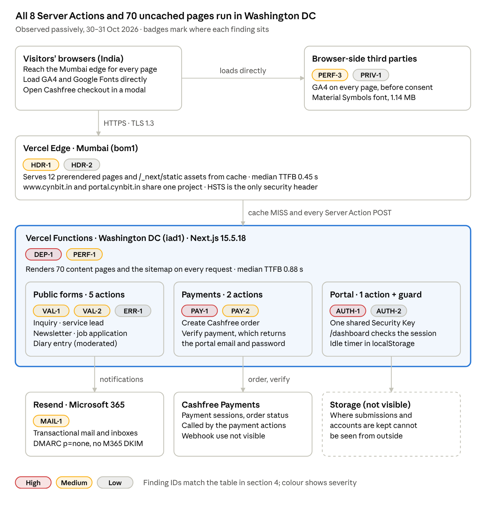

# Cynbit Backend Technical Audit

31 Oct 2026 · Passive review of [www.cynbit.in](https://www.cynbit.in/) and [portal.cynbit.in](https://portal.cynbit.in/)

> **Repository layout:** this README is the full report. [`recommendations/`](recommendations/) holds the code from section 5 as separate files, [`evidence/`](evidence/) holds the raw output of the passive checks, and [`assets/`](assets/) holds the diagram.

## 1. Executive summary

Cynbit's backend is one Next.js 15.5.18 application on Vercel, and its real API is eight public Server Actions. Fix three things first: a payment flow that sends portal passwords to the browser, a framework version two security releases behind, and a portal guarded by one shared "Security Key".

**19 findings: 3 high, 7 medium, 8 low, 1 informational.** The review was passive only: normal page loads of all 82 sitemap URLs and [portal.cynbit.in](https://portal.cynbit.in/), response headers, public DNS and TLS, and reading the JavaScript the browser already downloads. Nothing was submitted, logged into, fuzzed or load-tested. Data collected 30–31 Oct 2026.

**Fix first**

1. **Payment verification returns credentials (PAY-1, high).** After a Cashfree payment, `verifyBitelevatePayment` returns the new portal email and password to the browser. The BitElevate page re-runs that call from `order_id` and `token` in its own URL, a URL the page's Google Analytics tag also collects unless query redaction is configured.
2. **Next.js 15.5.18 is two security releases behind (DEP-1, high).** 15.5.21 (July 2026) and 15.5.28 (October 2026) each fix a Server Action denial-of-service bug that applies to this site; 15.5.28 also fixes a critical image-optimisation RCE. Security support for 15.x ends 31 Jan 2027.
3. **The portal login is one shared secret (AUTH-1, high).** portal.cynbit.in asks only for a "Security Key": no username, no visible rate limit, no second factor. One leaked key opens it for everyone.
4. **Public forms have no abuse controls (VAL-1, medium).** Six public Server Actions (inquiry, service lead, newsletter, job application, diary, payment order) rely on HTML `required` only: no CAPTCHA, honeypot, length limits or visible rate limits.
5. **70 of 82 pages render on every request in Washington DC (PERF-1, medium).** Blog, case-study, career and diary pages send `Cache-Control: no-store` and run in Vercel's default `iad1` region: median TTFB 0.88 s versus 0.45 s for edge-cached pages.

**Already done well:** HTTPS with TLS 1.3 and HSTS, Brotli, year-long immutable caching of hashed assets, a server-side `/dashboard` guard with `no-store`, `noindex` on the portal, no secrets or source maps in client bundles, diary entries reviewed before publishing, SPF with `-all`, and the built-in Server Action CSRF checks (POST only, Origin must match Host) described in the [Next.js data security guide](https://nextjs.org/docs/app/guides/data-security).

## 2. Architecture and attack surface

Everything runs in one Vercel project. A Mumbai edge serves 12 prerendered pages from cache; everything else (70 content pages, the sitemap, the portal guard and all eight Server Actions) runs in functions in Washington DC.



Only the 12 cached pages stop at the Mumbai edge; every form, payment and login crosses to functions in Washington DC, and the badges show which findings sit on each part.

### Observed stack

| Layer | What runs there | Evidence |
| --- | --- | --- |
| Hosting | One Vercel project serves `www.cynbit.in` and `portal.cynbit.in` | Both CNAME to `e12d688042344235.vercel-dns-017.com`; `Server: Vercel` |
| Edge | Mumbai (`bom1`) serves cached pages and `/_next/static` assets | `X-Vercel-Id: bom1::…`, `X-Vercel-Cache: HIT` |
| Compute | Functions in Washington DC (`iad1`), Vercel's default region for new projects ([Vercel docs](https://vercel.com/docs/functions/configuring-functions/region)) | `X-Vercel-Id: bom1::iad1::…` on every dynamic response |
| Framework | Next.js 15.5.18, App Router, bundled React 19.2 canary | `version:"15.5.18"` in the client bundle; `X-Powered-By: Next.js` on dynamic responses |
| API | 8 React Server Actions; no REST or GraphQL routes | `createServerReference(…)` in bundles; `/api/*` returns 404 |
| Payments | Cashfree Checkout JS v3 in a modal; the server creates the payment session | `/bitelevate` loads `sdk.cashfree.com/js/v3/cashfree.js` |
| Email | Microsoft 365 mailboxes; Resend for transactional mail | MX `cynbit-in.mail.protection.outlook.com`; DKIM key at `resend._domainkey`; SPF on `send.cynbit.in` |
| TLS | TLS 1.3 with 90-day Let's Encrypt certificates | `TLS_AES_128_GCM_SHA256`; issuer `Let's Encrypt YR2`; www certificate valid to 24 Dec 2026 |
| Third parties | Google Analytics 4 (`G-LK6CQWCWX0`) and Google Fonts on every page | `<head>` of every page |

### Request paths and caching

| Surface | Routes | Served from | Caching | Median TTFB |
| --- | --- | --- | --- | --- |
| Marketing pages | 12 (home, about, contact, services, products, BitElevate, legal) | Mumbai edge | Prerendered, `HIT` | 0.45 s |
| Content pages | 70 (`/blog/*`, `/case-studies/*`, `/careers/*`, `/diaries/*`) | `iad1` function | `private, no-cache, no-store`; `MISS` on repeat requests | 0.88 s (max 2.61 s) |
| Sitemap | `/sitemap.xml` (82 URLs) | `iad1` function | Regenerated on every request | 1.23 s warm, 3.01 s cold |
| Portal login | `portal.cynbit.in/` | Mumbai edge | Prerendered, `HIT`, `noindex` | 0.44 s |
| Portal dashboard | `portal.cynbit.in/dashboard` | `iad1` function | `private, no-store`; 307 to the login page when signed out | 0.59 s |
| Server Actions | 8, each a `POST` to its page URL with a `Next-Action` header | `iad1` function | None | Not measured (nothing submitted) |
| Static assets | `/_next/static/*` | Mumbai edge | `max-age=31536000, immutable` | Not measured |

TTFB was measured from a client in India and includes DNS, TCP and TLS setup (about 0.2–0.3 s): one load of each of the 82 sitemap URLs plus five repeats of each key route.

The portal host serves only portal routes (marketing paths return 404), but it shares `robots.txt`, `sitemap.xml`, the build and the release cycle with the marketing site. A framework bug, a bad deploy or an exhausted function therefore hits the payment flow and the portal as hard as the blog.

## 3. API and payload analysis

The site's whole API is eight Server Actions: six public forms, a token-gated payment check and the portal login. Next.js treats each one as a public `POST` endpoint that must authenticate and validate on its own, even if no page links to it ([Next.js data security guide](https://nextjs.org/docs/app/guides/data-security)).

| Action (ID prefix) | Page | Payload (FormData unless noted) | Access | Client handling |
| --- | --- | --- | --- | --- |
| `submitInquiry` (`40247ba446`) | `/contact` | fullName\*, email\*, company, industry, message\* | Public | Reads `success`; no `catch` |
| `submitServiceLead` (`40d4486f33`) | `/products`, `/services`, `/bitelevate/paths` | fullName\*, email\*, company\*, message\* | Public | Not traced |
| `subscribeToNewsletter` (`40cfc00a77`) | Pop-up on every page (after 5 s, once per browser) and `/blog` | email\* | Public | Reads `success`, `error`, `message`; no `catch` in the pop-up |
| `submitCandidateApplication` (`40645a00e0`) | `/careers/*` (20 roles) | fullName, email, phone, whatsapp, dob, gender, currentCity, permanentAddress, skills, noticePeriod, linkedinUrl, portfolioUrl, professionalProfileUrl, message, agreedToTerms, plus unnamed selects | Public | Reads `success`, `error`; no `catch` |
| `submitDiaryEntry` (`4026f27aeb`) | `/diaries` | fullName, email, role, title, story | Public; reviewed before publishing | Reads `success`, `error`; has `catch` |
| `createBitelevateCashfreeOrder` (`4045060553`) | `/bitelevate` | fullName, university, email, phone, track, duration, referralName, ambitions | Public | Expects `success`, `orderId`, `token`, `paymentSessionId`, `environment`; has `catch` |
| `verifyBitelevatePayment` (`6089502831`) | `/bitelevate` | Two arguments: `token`, `orderId`, also read from the page URL | Order token | Expects `success`, `orderStatus`, `bitElevateCredentials { email, password }`; has `catch` |
| `loginToPortal` (`40d93da1cc`) | `portal.cynbit.in/` | password, labelled "Security Key" | Login | Expects `success`, `error`; writes `cynbit_portal_last_activity` to localStorage, then redirects to `/dashboard` |

\* marked `required` in the HTML.

- **Contracts are ad hoc.** Each action returns its own `{ success, error?, … }` shape with free-text errors; there are no error codes or field-level errors for the UI to map, and no request ID to quote to support.
- **Validation is HTML-only on the client.** Inputs carry `required` and `type="email"` but no `maxLength`, patterns or URL checks; anything stricter must live on the server, where it cannot be observed.
- **The payment flow is the only multi-step contract.** Order creation returns a Cashfree `paymentSessionId`; after the modal closes, the client calls `verifyBitelevatePayment`. On a redirect return, the page repeats that call from `order_id` and `token` in its query string. If no `paymentSessionId` comes back, the client skips checkout and calls verify directly ("Verifying enrollment…").

## 4. Findings

The three high-severity findings all sit where money or access is handled: the payment flow, the framework every action runs on, and the portal login. Severity is the impact if the issue is real; confidence says how strongly the passive evidence supports it.

| ID | Finding | Severity | Confidence | Standard |
| --- | --- | --- | --- | --- |
| PAY-1 | Payment check returns the portal password and re-runs from a URL token | High | Likely | A07:2025 · CWE-522, CWE-598 |
| DEP-1 | Next.js 15.5.18 is two security releases behind | High | Confirmed | A03:2025 · CWE-1395 |
| AUTH-1 | Portal guarded by one shared "Security Key" | High | Confirmed | A07:2025 · CWE-308, CWE-307 |
| PAY-2 | Pricing and fulfilment rules cannot be verified from outside | Medium | Needs verification | A06:2025 · CWE-840 |
| VAL-1 | Six public actions without abuse controls | Medium | Likely | A06:2025 · CWE-770, CWE-20 |
| VAL-2 | Job form takes sensitive personal data and unchecked URLs | Medium | Confirmed | A05:2025 · CWE-79, CWE-359 |
| HDR-1 | No CSP, frame, nosniff, referrer or permissions headers | Medium | Confirmed | A02:2025 · CWE-1021, CWE-693 |
| MAIL-1 | DMARC `p=none`, no reports, no Microsoft 365 DKIM | Medium | Confirmed | RFC 7489 (DMARC) |
| PERF-1 | 70 of 82 pages rendered per request in Washington DC | Medium | Confirmed | Web Vitals: TTFB |
| PERF-3 | 1.14 MB icon font for 123 icons | Medium | Confirmed | Web Vitals: LCP |
| AUTH-2 | Idle timeout tracked in localStorage | Low | Needs verification | A07:2025 · CWE-613 |
| ERR-1 | Three form handlers have no `catch` | Low | Confirmed | A10:2025 · CWE-755 |
| HDR-2 | HSTS without `includeSubDomains` | Low | Confirmed | RFC 6797 (HSTS) |
| MAIL-2 | No CAA record | Low | Confirmed | RFC 8659 (CAA) |
| PERF-2 | Sitemap rebuilt on every request | Low | Confirmed | Sitemaps protocol |
| SEO-1 | Canonical host and tags are inconsistent | Low | Confirmed | RFC 6596 (canonical) |
| PRIV-1 | Analytics loads before any consent choice | Low | Likely | DPDP Act 2023 |
| OPS-1 | Stale `robots.txt` paths, no `security.txt`, SVG share image | Low | Confirmed | RFC 9116 (security.txt) |
| HDR-3 | `Access-Control-Allow-Origin: *` on static responses | Info | Confirmed | A02:2025 · CWE-942 |

Standards: [OWASP Top 10:2025](https://top10.owasp.org/2025) categories and CWE IDs, or the RFC that defines the control.

### Payments and fulfilment

**PAY-1 — Payment check returns the portal password**

- Evidence: `/bitelevate` reads `order_id` and `token` from its URL and calls `verifyBitelevatePayment(token, orderId)`. On success it renders `bitElevateCredentials.email` and `.password` with copy buttons. Google Analytics loads on the same page.
- Impact: anyone holding that URL (browser history, a shared link or screenshot, analytics reports) can repeat the call. If the server answers with the credentials again, the account is exposed; if it resets the password each time, a replay locks the student out. Returning a password at all means it is stored recoverably or regenerated on demand.

**PAY-2 — Pricing and fulfilment rules cannot be verified from outside**

- Evidence: the order form posts `track`, `duration` and `referralName` but no amount, so the server prices the order. When no `paymentSessionId` comes back, the client skips checkout and calls verify directly.
- Impact: if the server accepts unknown `track` or `duration` values or trusts referral input, an order can be mispriced or enrolled for free. If fulfilment depends on the browser calling verify rather than a signed Cashfree webhook, paid orders are missed when a tab closes early.

### Framework and dependencies

**DEP-1 — Next.js 15.5.18 is two security releases behind**

- Evidence: the client bundle reports `version:"15.5.18"`, and dynamic responses carry `X-Powered-By: Next.js`.
- Impact: the [July 2026 release](https://nextjs.org/blog/july-2026-security-release) (15.5.21) fixes CVE-2026-64641, a high-severity CPU-exhaustion DoS in any App Router app with a Server Action. [GHSA-p3m5-59mp-jv5r](https://github.com/vercel/next.js/security/advisories/GHSA-p3m5-59mp-jv5r), fixed in 15.5.28 (October 2026), is a second Server Action DoS (CVSS 8.2) with no workaround. 15.5.28 also fixes [GHSA-2464-fhr4-w9xw](https://github.com/vercel/next.js/security/advisories/GHSA-2464-fhr4-w9xw), a critical image-optimisation RCE via `sharp` on glibc Linux; the advisory does not say whether Vercel-hosted image optimisation is exposed. Security fixes for 15.x stop on 31 Jan 2027 ([support policy](https://nextjs.org/support-policy)).

### Authentication and session

**AUTH-1 — Portal guarded by one shared "Security Key"**

- Evidence: portal.cynbit.in shows a single "Security Key" field, and `loginToPortal` sends only `password`. The bundle has no CAPTCHA, lockout message or second factor.
- Impact: no per-user identity, audit trail or revocation. Anyone who learns the key keeps access until it changes for everyone, and guessing attacks aim at a single secret.

**AUTH-2 — Idle timeout tracked in the browser**

- Evidence: a successful login writes `cynbit_portal_last_activity` to localStorage.
- Impact: the browser can edit or ignore that value. If the server session has no idle or absolute expiry of its own, a copied session cookie stays valid indefinitely.

### Input validation and data handling

**VAL-1 — Six public actions without abuse controls**

- Evidence: the inquiry, service-lead, newsletter, job-application, diary and payment-order actions accept anonymous POSTs. No bundle contains a CAPTCHA, Turnstile or honeypot field, and no input has `maxLength`.
- Impact: scripts can flood inboxes and the database, burn the Resend email quota and open Cashfree orders in bulk. Server-side rate limits may exist but are not visible.

**VAL-2 — Job form takes sensitive personal data and unchecked URLs**

- Evidence: `submitCandidateApplication` collects date of birth, gender, permanent address, phone and WhatsApp numbers, plus three free-form profile URLs.
- Impact: this is the most sensitive personal data seen on the site, so its storage, access and retention need the most care under India's Digital Personal Data Protection Act 2023. If recruiters open these links from an admin screen, an unchecked `javascript:` URL becomes stored XSS against staff.

### Security headers and transport

**HDR-1 — No CSP, frame, nosniff, referrer or permissions headers**

- Evidence: none of `Content-Security-Policy`, `X-Frame-Options`, `X-Content-Type-Options`, `Referrer-Policy` or `Permissions-Policy` appears on any response, including `/bitelevate` and the portal login.
- Impact: the portal login can be framed for clickjacking, and any script injected into the payment page runs unrestricted.

**HDR-2 — HSTS without includeSubDomains**

- Evidence: `Strict-Transport-Security: max-age=63072000` on www, apex and portal.
- Impact: sub-domains a browser has not visited yet are not covered, and the domain cannot be preloaded.

**HDR-3 — `Access-Control-Allow-Origin: *` on static responses (informational)**

- Evidence: the header appears on prerendered HTML and static assets but not on function responses; nextjs.org and vercel.com send the same header.
- Impact: none today. Browsers never expose credentialed responses under `*`, and these responses are public anyway. Revisit only if personalised pages are ever cached at the edge.

### Email and DNS

**MAIL-1 — Spoofed @cynbit.in mail is not rejected**

- Evidence: `_dmarc.cynbit.in` is `v=DMARC1; p=none;` with no `rua` address, and the Microsoft 365 DKIM selectors `selector1` and `selector2` do not exist. SPF (`include:secureserver.net -all`) and Resend DKIM are in place.
- Impact: forged recruitment or payment emails from @cynbit.in reach inboxes, and Cynbit gets no report when it happens.

**MAIL-2 — No CAA record**

- Evidence: `cynbit.in` publishes no CAA record.
- Impact: any public certificate authority may issue certificates for the domain.

### Performance and caching

**PERF-1 — 70 of 82 pages rendered per request in Washington DC**

- Evidence: blog, case-study, career and diary pages return `Cache-Control: private, no-cache, no-store` and `X-Vercel-Cache: MISS` on repeat requests, routed `bom1::iad1`.
- Impact: median TTFB 0.88 s (max 2.61 s) against 0.45 s for cached pages, plus a function run, probably with a database query, for every view.

**PERF-2 — Sitemap rebuilt on every request**

- Evidence: two requests 1.4 s apart returned different `lastmod` values, each equal to its request time; TTFB was 1.23 s warm and 3.01 s cold.
- Impact: crawlers learn to ignore `lastmod`, and every crawl costs a function run.

**PERF-3 — 1.14 MB icon font for 123 icons**

- Evidence: every page loads Material Symbols Outlined with full weight and fill axes (`wght,FILL@100..700,0..1`) through a render-blocking stylesheet. The font file is 1.14 MB; the site uses 123 distinct icons.
- Impact: 3.7 times the home page's first-party JavaScript, CSS and fonts combined (301 KB compressed). With `display=swap`, icon names flash as plain words until the font arrives.

### Error handling

**ERR-1 — Three form handlers have no catch**

- Evidence: the inquiry, job-application and newsletter pop-up handlers `await` their action without `try/catch`; the diary and payment handlers do catch.
- Impact: a dropped connection or a thrown server error can leave the form stuck loading with no message and an unhandled promise rejection; users who retry create duplicates.

### SEO, privacy and housekeeping

**SEO-1 — Canonical host and tags are inconsistent**

- Evidence: `cynbit.in` 307-redirects to `www`, yet `og:url`, JSON-LD and all 82 sitemap URLs use the apex; only `/bitelevate` has a `<link rel="canonical">`.
- Impact: every crawled URL costs an extra redirect, and ranking signals split between two hosts.

**PRIV-1 — Analytics loads before any consent choice**

- Evidence: Google Analytics loads in the `<head>` of every page, and no consent logic appears in the bundles, although a `/cookies` policy page exists.
- Impact: analytics runs before visitors choose, and the payment return URLs from PAY-1 can reach Google.

**OPS-1 — Stale robots.txt paths, no security.txt, SVG share image**

- Evidence: `robots.txt` lists `/admin/` and `/api/`, both 404; `/.well-known/security.txt` and `/favicon.ico` return 404; `og:image` is the SVG logo on 56 of 82 pages.
- Impact: a public list of sensitive-sounding paths, no reporting channel for security researchers, and broken link previews on social platforms that do not render SVG.

## 5. Recommended improvements

Nine changes close all 19 findings. The first three remove every high-severity risk and fit in a week; the code targets Next.js 15.5 and carries over to 16.x.

### 5.1 Patch Next.js now, plan 16.x next (DEP-1)

Upgrade to 15.5.28 or newer today: it clears both Server Action DoS advisories and the image-optimisation RCE. Then set `poweredByHeader: false` (5.5) and let a bot raise framework security PRs automatically.

```bash
npm install next@15.5.28   # or the newest 15.5.x
npm ls next sharp          # the lockfile must resolve the patched versions
```

```yaml
# .github/dependabot.yml: framework security PRs within a day
version: 2
updates:
  - package-ecosystem: npm
    directory: /
    schedule:
      interval: daily
    groups:
      nextjs:
        patterns: ["next", "react", "react-dom", "eslint-config-next"]
```

Move to 16.x, the Active LTS line, before 15.x security support ends on 31 Jan 2027. On 16.x, `middleware.ts` becomes `proxy.ts`.

### 5.2 Fulfil payments from a signed webhook, never from the browser (PAY-1, PAY-2)

The browser should only ever learn an order's status. Payment state and account creation belong on the server, driven by Cashfree's signed webhook:

1. `createOrder` prices the order from a server-side catalogue, stores it as `PENDING` and ties it to an `HttpOnly` cookie instead of a URL token.
2. Cashfree's webhook, checked with `PGVerifyWebhookSignature` ([Cashfree docs](https://www.cashfree.com/docs/payments/online/webhooks/signature-verification)), is the only path that marks an order `PAID`, exactly once.
3. Marking it paid creates the account without a password and emails a single-use set-password link.
4. The page polls a status action that returns `PENDING`, `PAID` or `FAILED`, never credentials.

```ts
// app/bitelevate/actions.ts
'use server';
import 'server-only';
import { z } from 'zod';
import { cookies } from 'next/headers';
import { randomUUID } from 'node:crypto';
import { db } from '@/lib/db';
import { priceFor, TRACKS, DURATIONS } from '@/lib/catalogue'; // prices live only on the server
import { createCashfreeOrder } from '@/lib/cashfree';        // wraps Cashfree's create-order API

const OrderInput = z.object({
  fullName: z.string().trim().min(2).max(100),
  email: z.string().trim().toLowerCase().email().max(254),
  phone: z.string().trim().regex(/^\+?[0-9 ]{10,15}$/),
  university: z.string().trim().min(2).max(120),
  track: z.enum(TRACKS),          // unknown tracks are rejected, not priced
  duration: z.enum(DURATIONS),
  referralName: z.string().trim().max(100).optional(),
  ambitions: z.string().trim().max(2000),
});

export async function createOrder(form: FormData) {
  const input = OrderInput.safeParse(Object.fromEntries(form));
  if (!input.success) return { ok: false, code: 'INVALID_INPUT' } as const;

  const amount = priceFor(input.data.track, input.data.duration); // never read from the request
  const orderId = `be_${randomUUID()}`;
  await db.order.create({ data: { id: orderId, ...input.data, amount, status: 'PENDING' } });

  const session = await createCashfreeOrder({
    orderId,
    amount,
    customer: { id: orderId, email: input.data.email, phone: input.data.phone },
    returnUrl: 'https://www.cynbit.in/bitelevate/status', // carries no secret
  });

  (await cookies()).set('__Host-be-order', orderId, {
    httpOnly: true, secure: true, sameSite: 'lax', path: '/', maxAge: 60 * 60,
  });
  return { ok: true, paymentSessionId: session.paymentSessionId } as const;
}

export async function getOrderStatus() {
  const orderId = (await cookies()).get('__Host-be-order')?.value;
  if (!orderId) return { status: 'UNKNOWN' } as const;
  const order = await db.order.findUnique({ where: { id: orderId }, select: { status: true } });
  return { status: order?.status ?? 'UNKNOWN' } as const; // status only, never credentials
}
```

```ts
// app/api/payments/cashfree/route.ts: the only code that marks an order paid
import { cashfree } from '@/lib/cashfree';
import { db } from '@/lib/db';
import { provisionAccount } from '@/lib/accounts';

export async function POST(req: Request) {
  const rawBody = await req.text(); // Cashfree signs the raw bytes, not parsed JSON
  try {
    cashfree.PGVerifyWebhookSignature(
      req.headers.get('x-webhook-signature') ?? '',
      rawBody,
      req.headers.get('x-webhook-timestamp') ?? '',
    ); // throws on mismatch
  } catch {
    return new Response('invalid signature', { status: 401 });
  }

  const event = JSON.parse(rawBody);
  if (event.type !== 'PAYMENT_SUCCESS_WEBHOOK') return new Response('ignored');

  const { order_id, order_amount } = event.data.order;
  // Atomic and idempotent: only the first matching delivery flips PENDING to PAID
  const { count } = await db.order.updateMany({
    where: { id: order_id, status: 'PENDING', amount: order_amount },
    data: { status: 'PAID', paidAt: new Date() },
  });
  if (count === 1) await provisionAccount(order_id);
  return new Response('ok');
}
```

```ts
// lib/accounts.ts: no password ever leaves the server
import 'server-only';
import { randomBytes, createHash } from 'node:crypto';
import { db } from '@/lib/db';
import { sendSetPasswordEmail } from '@/lib/email'; // Resend

export async function provisionAccount(orderId: string) {
  const order = await db.order.findUniqueOrThrow({ where: { id: orderId } });
  const user = await db.user.upsert({
    where: { email: order.email },
    create: { email: order.email, passwordHash: null },
    update: {},
  });
  const token = randomBytes(32).toString('base64url');
  await db.passwordSetup.create({
    data: {
      userId: user.id,
      tokenHash: createHash('sha256').update(token).digest('hex'), // store only the hash
      expiresAt: new Date(Date.now() + 30 * 60_000),                // 30 minutes, single use
    },
  });
  await sendSetPasswordEmail(order.email, `https://portal.cynbit.in/set-password#${token}`);
}
```

The token travels in the URL fragment, which browsers never send to servers or in `Referer` headers; the set-password page loads no analytics and consumes the token on first use. Until the old flow is retired, turn on GA4 query-parameter redaction for `order_id` and `token`.

### 5.3 Per-user portal accounts with rate limits and server sessions (AUTH-1, AUTH-2)

BitElevate already issues per-user email accounts. Move the Cynbit Portal onto the same identity store, or a managed provider such as Auth.js, Clerk or Supabase Auth, and retire the shared key. Until then, rotate the key and put the rate limit below in front of it.

```ts
// app/portal/actions.ts
'use server';
import 'server-only';
import { z } from 'zod';
import { headers } from 'next/headers';
import argon2 from 'argon2';
import { Ratelimit } from '@upstash/ratelimit';
import { Redis } from '@upstash/redis';
import { verifyTurnstile } from '@/lib/turnstile';
import { createSession } from '@/lib/session';
import { db } from '@/lib/db';

const redis = Redis.fromEnv();
const perIp = new Ratelimit({ redis, limiter: Ratelimit.slidingWindow(10, '15 m'), prefix: 'login:ip' });
const perAccount = new Ratelimit({ redis, limiter: Ratelimit.slidingWindow(5, '15 m'), prefix: 'login:acct' });
const DUMMY_HASH = process.env.DUMMY_ARGON2_HASH!; // hash of a random string: unknown emails take as long

const Login = z.object({
  email: z.string().trim().toLowerCase().email().max(254),
  password: z.string().min(12).max(128),
  'cf-turnstile-response': z.string().min(1),
});

export async function loginToPortal(form: FormData) {
  const input = Login.safeParse(Object.fromEntries(form));
  if (!input.success) return { ok: false, code: 'INVALID_CREDENTIALS' } as const;

  const ip = (await headers()).get('x-real-ip') ?? 'unknown';
  const [byIp, byAccount] = await Promise.all([perIp.limit(ip), perAccount.limit(input.data.email)]);
  if (!byIp.success || !byAccount.success) return { ok: false, code: 'RATE_LIMITED' } as const;
  if (!(await verifyTurnstile(input.data['cf-turnstile-response'], ip)))
    return { ok: false, code: 'BOT_CHECK_FAILED' } as const;

  const user = await db.user.findUnique({ where: { email: input.data.email } });
  const valid = await argon2.verify(user?.passwordHash ?? DUMMY_HASH, input.data.password);
  if (!user || !valid) return { ok: false, code: 'INVALID_CREDENTIALS' } as const;

  await createSession(user.id); // a new random session ID on every login
  return { ok: true } as const;
}
```

```ts
// lib/session.ts: opaque session ID; the server enforces both timeouts
import 'server-only';
import { cookies } from 'next/headers';
import { randomBytes, createHash } from 'node:crypto';
import { Redis } from '@upstash/redis';

const redis = Redis.fromEnv();
const IDLE_SECONDS = 30 * 60;          // signed out after 30 idle minutes
const ABSOLUTE_MS = 12 * 60 * 60_000;  // and after 12 hours regardless
const keyFor = (id: string) => `session:${createHash('sha256').update(id).digest('hex')}`;

export async function createSession(userId: string) {
  const id = randomBytes(32).toString('base64url');
  await redis.set(keyFor(id), { userId, createdAt: Date.now() }, { ex: IDLE_SECONDS });
  (await cookies()).set('__Host-session', id, { httpOnly: true, secure: true, sameSite: 'lax', path: '/' });
}

export async function getSession() {
  const id = (await cookies()).get('__Host-session')?.value;
  if (!id) return null;
  const session = await redis.get<{ userId: string; createdAt: number }>(keyFor(id));
  if (!session || Date.now() - session.createdAt > ABSOLUTE_MS) return null;
  await redis.expire(keyFor(id), IDLE_SECONDS); // slide the idle window
  return session;
}
```

```ts
// lib/turnstile.ts: Cloudflare Turnstile server-side check
export async function verifyTurnstile(token: string, ip: string) {
  const res = await fetch('https://challenges.cloudflare.com/turnstile/v0/siteverify', {
    method: 'POST',
    body: new URLSearchParams({ secret: process.env.TURNSTILE_SECRET_KEY!, response: token, remoteip: ip }),
  });
  return res.ok && (await res.json()).success === true;
}
```

The per-account limit slows guessing against one user; pair it with an emailed reset link so an attacker cannot keep a real user locked out. `/dashboard` and every portal action then call `getSession()` themselves, as the [Next.js data security guide](https://nextjs.org/docs/app/guides/data-security) requires.

### 5.4 One hardened wrapper for every Server Action (VAL-1, VAL-2, ERR-1)

Every public action passes the same gate: schema validation, a honeypot, a per-IP rate limit, a bot check, a typed result with error codes, and a logged `requestId` without form contents.

```ts
// lib/action.ts
import 'server-only';
import { z } from 'zod';
import { headers } from 'next/headers';
import { Ratelimit } from '@upstash/ratelimit';
import { Redis } from '@upstash/redis';
import { verifyTurnstile } from '@/lib/turnstile';
import { log } from '@/lib/log';

type ErrorCode = 'INVALID_INPUT' | 'RATE_LIMITED' | 'BOT_CHECK_FAILED' | 'INTERNAL';
export type ActionResult<T> =
  | { ok: true; data: T }
  | { ok: false; code: ErrorCode; requestId: string; fieldErrors?: Record<string, string[] | undefined> };

const limiter = new Ratelimit({
  redis: Redis.fromEnv(),
  limiter: Ratelimit.slidingWindow(5, '10 m'),
  prefix: 'action',
});

export function publicAction<S extends z.ZodTypeAny, T>(
  name: string,
  schema: S,
  run: (input: z.infer<S>) => Promise<T>,
) {
  return async (form: FormData): Promise<ActionResult<T | null>> => {
    const h = await headers();
    const requestId = h.get('x-vercel-id') ?? crypto.randomUUID();
    const ip = h.get('x-real-ip') ?? 'unknown';

    if (form.get('website')) return { ok: true, data: null }; // honeypot filled: drop silently
    const parsed = schema.safeParse(Object.fromEntries(form));
    if (!parsed.success)
      return { ok: false, code: 'INVALID_INPUT', requestId, fieldErrors: parsed.error.flatten().fieldErrors };
    if (!(await limiter.limit(`${name}:${ip}`)).success) return { ok: false, code: 'RATE_LIMITED', requestId };
    if (!(await verifyTurnstile(String(form.get('cf-turnstile-response') ?? ''), ip)))
      return { ok: false, code: 'BOT_CHECK_FAILED', requestId };

    try {
      return { ok: true, data: await run(parsed.data) };
    } catch (err) {
      log.error({ action: name, requestId, err }); // no form contents in logs
      return { ok: false, code: 'INTERNAL', requestId };
    }
  };
}
```

```ts
// app/careers/actions.ts: stricter schema, less personal data
'use server';
import { z } from 'zod';
import { publicAction } from '@/lib/action';
import { db } from '@/lib/db';
import { enqueue } from '@/lib/queue';

const optionalHttpsUrl = z.preprocess(
  (v) => (v === '' ? undefined : v),
  z.string().trim().url().max(300)
    .refine((u) => new URL(u).protocol === 'https:', 'Use an https:// link') // blocks javascript: URLs
    .optional(),
);

export const submitCandidateApplication = publicAction(
  'apply',
  z.object({
    fullName: z.string().trim().min(2).max(100),
    email: z.string().trim().toLowerCase().email().max(254),
    phone: z.string().trim().regex(/^\+?[0-9 ]{10,15}$/),
    skills: z.string().trim().max(500),
    linkedinUrl: optionalHttpsUrl,
    portfolioUrl: optionalHttpsUrl,
    professionalProfileUrl: optionalHttpsUrl,
    message: z.string().trim().max(3000).optional(),
    agreedToTerms: z.literal('on'),
    // dob, gender, permanentAddress: removed until a hiring step needs them
  }),
  async (input) => {
    const { id } = await db.application.create({ data: input }); // encrypted at rest, fixed retention
    await enqueue('notify-recruiters', { applicationId: id });   // the email carries an ID, not the data
    return { applicationId: id };
  },
);
```

```tsx
// Any form: the button always recovers and the user sees why
async function onSubmit(e: React.FormEvent<HTMLFormElement>) {
  e.preventDefault();
  setState({ status: 'sending' });
  try {
    const res = await submitCandidateApplication(new FormData(e.currentTarget));
    setState(res.ok ? { status: 'sent' } : { status: 'error', code: res.code, fieldErrors: res.fieldErrors });
  } catch {
    setState({ status: 'error', code: 'NETWORK' }); // the request never completed
  }
}
```

Add a hidden `website` input and the Turnstile widget to each form, plus `maxLength` attributes that match the schema. Show the `requestId` in error messages so support can find the log line.

### 5.5 Security headers and a CSP that keep static caching (HDR-1, HDR-2)

A nonce-based CSP forces every page to render dynamically and turns off CDN caching ([Next.js CSP guide](https://nextjs.org/docs/app/guides/content-security-policy)), which would undo the site's fastest pages. Use a header-based CSP for the static marketing site, in report-only mode for the first week, and keep nonces for the portal, which renders dynamically anyway.

```js
// next.config.js
const csp = [
  "default-src 'self'",
  "script-src 'self' 'unsafe-inline' https://www.googletagmanager.com https://sdk.cashfree.com",
  "style-src 'self' 'unsafe-inline' https://fonts.googleapis.com",
  "font-src 'self' https://fonts.gstatic.com",
  "img-src 'self' data: blob: https://*.google-analytics.com https://*.googletagmanager.com",
  "connect-src 'self' https://*.google-analytics.com https://*.analytics.google.com https://*.cashfree.com",
  "frame-src https://*.cashfree.com",
  "frame-ancestors 'none'",
  "object-src 'none'",
  "base-uri 'self'",
  "form-action 'self' https://*.cashfree.com",
  'upgrade-insecure-requests',
  'report-uri /api/csp-report', // a route handler that logs violation reports
].join('; ');

const securityHeaders = [
  { key: 'Content-Security-Policy-Report-Only', value: csp }, // rename to Content-Security-Policy after a clean week
  { key: 'Strict-Transport-Security', value: 'max-age=63072000; includeSubDomains' },
  { key: 'X-Frame-Options', value: 'DENY' },
  { key: 'X-Content-Type-Options', value: 'nosniff' },
  { key: 'Referrer-Policy', value: 'strict-origin-when-cross-origin' },
  { key: 'Permissions-Policy', value: 'camera=(), microphone=(), geolocation=()' },
];

module.exports = {
  poweredByHeader: false,
  experimental: { serverActions: { bodySizeLimit: '256kb' } }, // forms are small; the default is 1 MB
  async headers() {
    return [{ source: '/:path*', headers: securityHeaders }];
  },
};
```

`'unsafe-inline'` keeps Next.js's inline bootstrap scripts working on static pages. `frame-ancestors`, `object-src`, `base-uri`, `form-action` and the `connect-src` allow-list still block clickjacking, plugin injection and most data exfiltration. To drop `'unsafe-inline'` without going dynamic, test the experimental hash-based SRI mode from the same guide. Add `preload` to HSTS only after every sub-domain serves HTTPS, because leaving the preload list is slow ([hstspreload.org](https://hstspreload.org/)).

### 5.6 Serve content pages from the edge (PERF-1, PERF-2)

First find what forces those routes to render per request: a `cookies()` or `headers()` call in a shared layout, a `fetch` with `cache: 'no-store'`, or `export const dynamic = 'force-dynamic'`. Then pre-render them and refresh on publish.

```ts
// app/blog/[slug]/page.tsx (same pattern for case studies, careers and diaries)
import { unstable_cache } from 'next/cache';
import { db } from '@/lib/db';

export const revalidate = 3600;     // served from the edge, refreshed at most hourly
export const dynamicParams = true;  // a new slug renders once, then caches

const getPost = unstable_cache(
  async (slug: string) => db.post.findFirst({ where: { slug, published: true } }),
  ['post'],
  { tags: ['posts'] },
);

export async function generateStaticParams() {
  const posts = await db.post.findMany({ where: { published: true }, select: { slug: true } });
  return posts.map(({ slug }) => ({ slug }));
}
```

```ts
// wherever a post is published or a diary entry approved
import { revalidateTag } from 'next/cache';
revalidateTag('posts'); // on 16.x, also pass a cache profile such as 'max'
```

```ts
// app/sitemap.ts: rebuilt at most daily, with real modification dates
import type { MetadataRoute } from 'next';
import { db } from '@/lib/db';
import { siteUpdatedAt } from '@/content/site';

export const revalidate = 86400;
const BASE = 'https://www.cynbit.in';

export default async function sitemap(): Promise<MetadataRoute.Sitemap> {
  const posts = await db.post.findMany({ where: { published: true }, select: { slug: true, updatedAt: true } });
  return [
    { url: `${BASE}/`, lastModified: siteUpdatedAt },
    ...posts.map((p) => ({ url: `${BASE}/blog/${p.slug}`, lastModified: p.updatedAt })),
  ];
}
```

Once these pages are cached, the function region matters only for form submissions and the portal. Move functions to Mumbai (`bom1`) only together with the database: Vercel advises running functions close to their data source ([Vercel docs](https://vercel.com/docs/functions/configuring-functions/region)).

### 5.7 Email authentication and certificate control (MAIL-1, MAIL-2)

```text
; 1. Microsoft 365 DKIM: copy both values from Microsoft Defender > Email authentication > DKIM, then enable signing
selector1._domainkey.cynbit.in.  CNAME  <value shown in Microsoft 365>
selector2._domainkey.cynbit.in.  CNAME  <value shown in Microsoft 365>

; 2. DMARC: collect reports now, enforce once every legitimate sender passes
_dmarc.cynbit.in.  TXT  "v=DMARC1; p=none; rua=mailto:dmarc-reports@cynbit.in"
; after 2-4 clean weeks: p=quarantine, then p=reject

; 3. CAA: only the certificate authority Vercel uses for these hosts may issue
cynbit.in.  CAA  0 issue "letsencrypt.org"
cynbit.in.  CAA  0 iodef "mailto:security@cynbit.in"
```

Confirm which authority Vercel currently uses before publishing the CAA record; the certificates seen on 30 Oct 2026 came from Let's Encrypt.

### 5.8 Lighter pages, consent and housekeeping (PERF-3, PRIV-1, SEO-1, OPS-1)

**Icons.** Swap the full Material Symbols font for per-icon SVG components, or request only the icons in use, at one weight, with `display=block` so ligature names never flash as text.

```html
<link rel="stylesheet"
  href="https://fonts.googleapis.com/css2?family=Material+Symbols+Outlined:wght,FILL@400,0..1&icon_names=arrow_forward,lock,verified&display=block">
```

**Consent.** Start Google Analytics with consent denied, load this before the GA tag (for example with `next/script` and `strategy="beforeInteractive"`), and update it from the cookie banner.

```html
<script>
  window.dataLayer = window.dataLayer || [];
  function gtag(){ dataLayer.push(arguments); }
  gtag('consent', 'default', {
    analytics_storage: 'denied', ad_storage: 'denied', ad_user_data: 'denied', ad_personalization: 'denied',
  });
  // on "Accept": gtag('consent', 'update', { analytics_storage: 'granted' });
</script>
```

**Canonical host.** Make `cynbit.in` → `www` a permanent 308 in Vercel's domain settings and emit a canonical tag on every page.

```ts
// app/layout.tsx
export const metadata = { metadataBase: new URL('https://www.cynbit.in') };

// app/blog/[slug]/page.tsx
export async function generateMetadata({ params }: { params: Promise<{ slug: string }> }) {
  const { slug } = await params;
  return { alternates: { canonical: `/blog/${slug}` } };
}
```

**Housekeeping.** Remove `/admin/` and `/api/` from `robots.txt`; publish `/.well-known/security.txt` with `Contact` and `Expires` fields (RFC 9116); use a 1200×630 PNG `og:image`; add `/favicon.ico`.

### 5.9 Give the portal and payments their own deployment

Split `portal.cynbit.in` and the BitElevate checkout into a separate Vercel project with its own release gate, a strict nonce-based CSP and no marketing scripts. A blog deploy, a marketing-form DoS or a third-party script incident then cannot reach payments or client data, and the portal can patch on its own schedule.

## 6. Remediation roadmap

Week 1 removes or contains every high-severity risk; the rest fits in one sprint, plus a planned move to Next.js 16 before 31 Jan 2027. HDR-3 needs no change.

| When | Change | Closes | Effort (estimate) |
| --- | --- | --- | --- |
| Week 1 | Upgrade to Next.js 15.5.28+, `poweredByHeader: false`, Dependabot | DEP-1 | 2–4 h plus a regression pass |
| Week 1 | Verify returns status only; no passwords in responses; GA query redaction | PAY-1 | 1 day |
| Week 1 | Rotate the Security Key; rate limit and Turnstile on `loginToPortal` | AUTH-1 (interim) | 3–4 h |
| Week 1 | Security headers on, CSP in report-only, HSTS `includeSubDomains` | HDR-1, HDR-2 | 2 h |
| Weeks 2–3 | Signed Cashfree webhook, server price catalogue, set-password emails | PAY-1, PAY-2 | 3–5 days |
| Weeks 2–3 | `publicAction` wrapper on every action; drop unneeded personal data | VAL-1, VAL-2, ERR-1 | 2–3 days |
| Weeks 2–3 | Pre-render content pages; daily sitemap | PERF-1, PERF-2 | 1–2 days |
| Weeks 2–3 | Microsoft 365 DKIM, DMARC reports, CAA | MAIL-1, MAIL-2 | 2 h, then 2–4 weeks of reports |
| This quarter | Per-user portal accounts with server sessions | AUTH-1, AUTH-2 | 1–2 weeks |
| This quarter | Enforce the CSP; split portal and payments into their own project | HDR-1 | 2–3 days |
| This quarter | Icon subset, consent mode, canonical tags, housekeeping | PERF-3, PRIV-1, SEO-1, OPS-1 | 1–2 days |
| Before 31 Jan 2027 | Upgrade to Next.js 16.x (Active LTS) | DEP-1 | 3–5 days |

## 7. Verification checklist

Each check is passive and proves one fix landed.

- [ ] In the browser console on www.cynbit.in, `next.version` reports 15.5.28 or later.
- [ ] `curl -sI https://www.cynbit.in/` shows CSP, `X-Frame-Options`, `X-Content-Type-Options`, `Referrer-Policy` and `Permissions-Policy`, and no `X-Powered-By`.
- [ ] Reloading a used payment return URL shows the order status only, never credentials.
- [ ] A Cashfree sandbox webhook with a bad signature gets 401; a valid one marks the order `PAID` exactly once.
- [ ] The 11th failed portal login from one IP within 15 minutes returns `RATE_LIMITED`.
- [ ] A form posted with the honeypot filled is dropped; the 6th post from one IP within 10 minutes returns `RATE_LIMITED`.
- [ ] A second request to any `/blog/*` page returns `X-Vercel-Cache: HIT`.
- [ ] Two sitemap requests return identical `lastmod` values.
- [ ] `dig +short TXT _dmarc.cynbit.in` shows a `rua=` address, and later `p=quarantine` or `p=reject`.
- [ ] `dig +short CAA cynbit.in` lists `letsencrypt.org`.

## Appendix A. Methodology and limits

The review used only what any visitor's browser receives.

- **Requests:** one GET for each of the 82 sitemap URLs and the portal login page; five repeats of six key routes for timing; header-only checks; about a dozen single GETs to paths listed in `robots.txt`, well-known files (`security.txt`, `manifest.json`, `favicon.ico`) and one made-up path to see the 404 page. No POST was sent, no Server Action called and no login attempted.
- **Code reading:** the 30 unique JavaScript chunks those pages load, plus the portal's, searched for Server Action references, form fields, storage keys, version strings, secret patterns and source-map links.
- **Public records:** DNS over HTTPS (`dns.google`) for MX, SPF, DMARC, DKIM selectors, CAA and CNAME records; one TLS handshake per host with OpenSSL.
- **Tools:** curl 8.7.1, OpenSSL `s_client` and grep. Response headers from nextjs.org and vercel.com were fetched once to confirm Vercel's default CORS header.
- **Limits:** server code, databases, logs and server-side rate limits are invisible from outside, so findings rated *Likely* or *Needs verification* should be confirmed with code access before work starts. Timings come from one client in India on 30–31 Oct 2026.

## Appendix B. Evidence

```text
# Edge-cached marketing page
GET https://www.cynbit.in/
HTTP/1.1 200 OK
Access-Control-Allow-Origin: *
Cache-Control: public, max-age=0, must-revalidate
Server: Vercel
Strict-Transport-Security: max-age=63072000
X-Nextjs-Prerender: 1
X-Vercel-Cache: HIT
X-Vercel-Id: bom1::pn7fs-1793386543517-b1781b779c64

# Content page rendered per request in iad1 (same on the second request)
GET https://www.cynbit.in/blog/ai-lead-generation
Cache-Control: private, no-cache, no-store, max-age=0, must-revalidate
X-Vercel-Cache: MISS
X-Vercel-Id: bom1::iad1::8g6gt-1793386636758-e1d18b382109

# Portal dashboard, signed out
GET https://portal.cynbit.in/dashboard
HTTP/1.1 307 Temporary Redirect
Cache-Control: private, no-cache, no-store, max-age=0, must-revalidate
Location: /
X-Powered-By: Next.js
X-Vercel-Id: bom1::iad1::zbmhd-1793386544638-83afd972d1ab
```

```text
# Server Action references in client bundles (ID prefix, name)
40247ba446  submitInquiry
40d4486f33  submitServiceLead
40cfc00a77  subscribeToNewsletter
40645a00e0  submitCandidateApplication
4026f27aeb  submitDiaryEntry
4045060553  createBitelevateCashfreeOrder
6089502831  verifyBitelevatePayment
40d93da1cc  loginToPortal

# Framework version string in the client bundle
version:"15.5.18"
```

```js
// /bitelevate payment chunk (minified, trimmed)
let e=new URLSearchParams(window.location.search),t=e.get("order_id"),a=e.get("token");
t&&a&&(d(!0),h("Verifying payment transaction with Cashfree..."),c(a,t).then(e=>{
  e.success?(b(!0),e.bitElevateCredentials&&y(e.bitElevateCredentials)):…
… children:g.email … children:g.password …

// portal.cynbit.in login chunk (minified, trimmed)
let t=new FormData;t.append("password",e);let a=await l(t);
if(a.success){try{localStorage.setItem("cynbit_portal_last_activity",Date.now().toString())}catch(e){}
window.location.href="/dashboard"}

// /contact inquiry handler (minified, trimmed): no try/catch around the await
d=async e=>{e.preventDefault(),t(!0),n(null);let a=new FormData(e.currentTarget),r=await x(a);
t(!1),r.success?i(!0):n("Something went wrong. Please try again or email us directly.")}
```

```text
# DNS (dns.google, 30 Oct 2026)
cynbit.in.                      MX     0 cynbit-in.mail.protection.outlook.com.
cynbit.in.                      TXT    "v=spf1 include:secureserver.net -all"
_dmarc.cynbit.in.               TXT    "v=DMARC1; p=none;"
resend._domainkey.cynbit.in.    TXT    "p=MIGfMA0GCSqGSIb3DQEBAQUAA4GNADCBiQKBgQDm…"
selector1._domainkey.cynbit.in         NXDOMAIN
selector2._domainkey.cynbit.in         NXDOMAIN
cynbit.in.                      CAA    (none)
www / portal.cynbit.in.         CNAME  e12d688042344235.vercel-dns-017.com.

# TLS
www.cynbit.in     TLSv1.3  TLS_AES_128_GCM_SHA256  Let's Encrypt YR2  valid 25 Sep - 24 Dec 2026
portal.cynbit.in  TLSv1.3  TLS_AES_128_GCM_SHA256  Let's Encrypt YR2  valid 6 Oct 2026 - 4 Jan 2027

# TTFB from India, one load per sitemap URL (seconds)
edge HIT   n=12  min 0.35  median 0.45  max 1.21
iad1 MISS  n=70  min 0.66  median 0.88  max 2.61
```

## Sources

- [Next.js July 2026 Security Release](https://nextjs.org/blog/july-2026-security-release)
- [GHSA-p3m5-59mp-jv5r: Denial of Service in App Router using Server Actions](https://github.com/vercel/next.js/security/advisories/GHSA-p3m5-59mp-jv5r)
- [GHSA-2464-fhr4-w9xw: Unauthenticated RCE in Image Optimization API when SVG files are used](https://github.com/vercel/next.js/security/advisories/GHSA-2464-fhr4-w9xw)
- [Next.js support policy](https://nextjs.org/support-policy)
- [Next.js: How to think about data security](https://nextjs.org/docs/app/guides/data-security)
- [Next.js: Content Security Policy](https://nextjs.org/docs/app/guides/content-security-policy)
- [Vercel: Configuring regions for Vercel Functions](https://vercel.com/docs/functions/configuring-functions/region)
- [Cashfree: webhook signature verification](https://www.cashfree.com/docs/payments/online/webhooks/signature-verification)
- [HSTS preload list submission requirements](https://hstspreload.org/)
- [OWASP Top 10:2025](https://top10.owasp.org/2025)
- Audited site: [www.cynbit.in](https://www.cynbit.in/), [sitemap.xml](https://www.cynbit.in/sitemap.xml), [robots.txt](https://www.cynbit.in/robots.txt), [portal.cynbit.in](https://portal.cynbit.in/)
